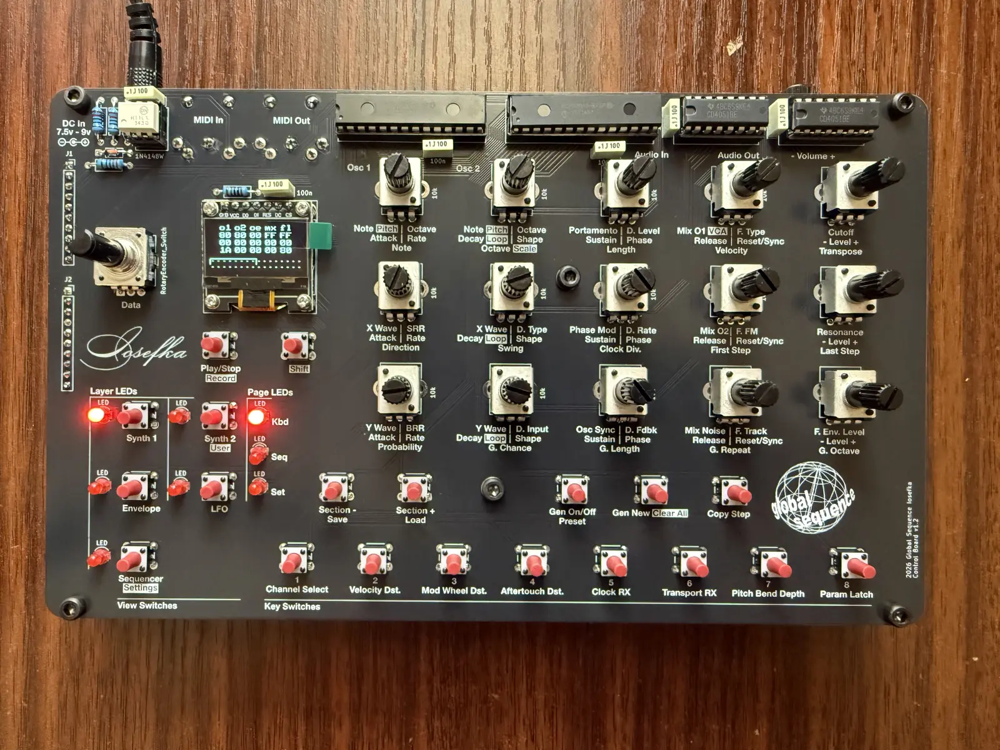

# Iosefka

## Specification

Iosefka is a hybrid digital analog monophonic synthesizer consisting of the following parts:

**Digital audio:**

- 2x wavetable oscillators, capable of interpolated morphing waveforms in the X and Y dimension along 256 hand-picked waveforms in a 16x16 layout
- White noise generator
- Sample-rate reduction and Bit-rate reduction effects
- Loopback digital delay fed from VCA output with feedback and adjustable rate from >3 ms to ~683 ms

**Analog audio:**

- V2140 based analog pole-mixing resonant voltage controlled filter with audio rate frequency modulation selectable between:
    - 2 pole low pass
    - 4 pole low pass
    - 2 pole high pass
    - 2 pole band pass
- LM13700 based voltage controlled amplifier
- External audio input direct into analog section and digital delay

**Step sequencer:**

- 32 step, 24 PPQ performance step sequencer
- Parameterized sequence generator including step chance, length, octave range, and musical scale
- Controls for swing, direction, clock division, first and last step, probability
- Per step Parameter locks for:
    - Note value
    - Step length
    - Velocity value
    - Step Probability
    - Single audio Parameter
- Per step mutes

**Modulation matrix to all audio Parameters:**

- 3x ADSR envelope generators (converted to control voltage for analog modules)
- 3x Low frequency oscillators (converted to control voltage for analog modules)
- Velocity control
- Aftertouch control
- Mod Wheel control
- Breath Control
- Pitch Bend Control

**MIDI Implementation:**

- **MIDI RX**
    - Note and velocity values
    - Realtime messages: clock tick, start, stop
    - CC messages for all audio Parameters (see implementation chart)
    - Modulation control of velocity, aftertouch, mod-wheel
    - Pitch bend with configurable bend range from 1 to 12 semitones
    - Program change (coming soon)
- **MIDI TX**
    - Note and velocity values (from keyboard and sequencer)
    - Realtime messages: clock tick, start, stop

**Patch storage:**

- Store 64 patches of all audio and sequencer Parameters
- Store global MIDI and machine settings

**Oscilloscope:**

- Oscillator phase locked oscilloscope with four 'time' divisions (sample divisions) between 512 to 128 samples.

# Link to the Manual
[Iosefka Manual](https://globalsequence.github.io/iosefka/#)

# Link to the Build Guide
[Build Guide - Iosefka Manual](https://globalsequence.github.io/iosefka/#build_guide/) (It's part of the manual)

# Gerber Files for Ordering the PCBs
This project includes hardware design files, as well as the gerber files which are required for PCB fabrication. The gerber files for the different boards will be found in the locations linked below. There is also a compressed zip file of all of the gerber files within this folder if that's the format your PCB fab of choice requires. 

- [iosefka bottomboard gerbers](./hardware/iosefka_bottomboard/gerbers/)
- [iosefka controlboard gerbers](./hardware/iosefka_controlboard/gerbers/)
- [iosefka motherboard gerbers](./hardware/iosefka_motherboard/gerbers)

# Bill of Materials
The three bills of materials can be found in the hardware folder of this project. 

- [iosefka boms](./hardware/boms/)

# Precompiled firmware
You can download the most current Iosefka firmware from the Releases section of this github repository. Or you can click this link: https://github.com/GlobalSequence/iosefka/releases. 

# A Note to Developers, Engineers, and People Generally Experienced in Programming and Electronics

Take this as a content warning for what you are about to see should you so much as peek into the code of this repository. It may help to frame this whole thing as a hobbyist's project that got way out of hand. I chalk any and all glaring errors up to the fundamental tension of this machine which was 'I want to create/finish this thing' vs. 'I want to learn this stuff'.

It is resoundingly true that the whole is better than the sum of its parts.

With all of that laid bare, please feel free to reach out to me about any suggestions, recommended fixes, or outright errors in both the code and the schematic. I consider the post-release critique the most enduring part of the learning process. globeseq@gmail.com 

# DISCLAIMER
This project is provided for informational and educational purposes only. By using the provided instructions, code, and hardware designs, you acknowledge that you are solely responsible for your own safety and the cost of any materials or components used.