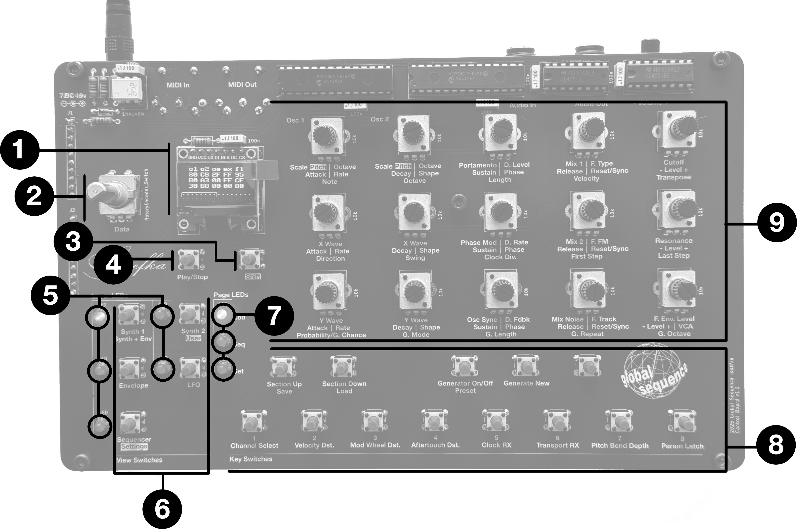
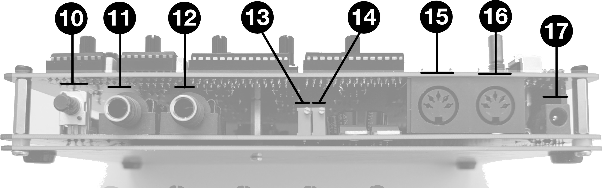
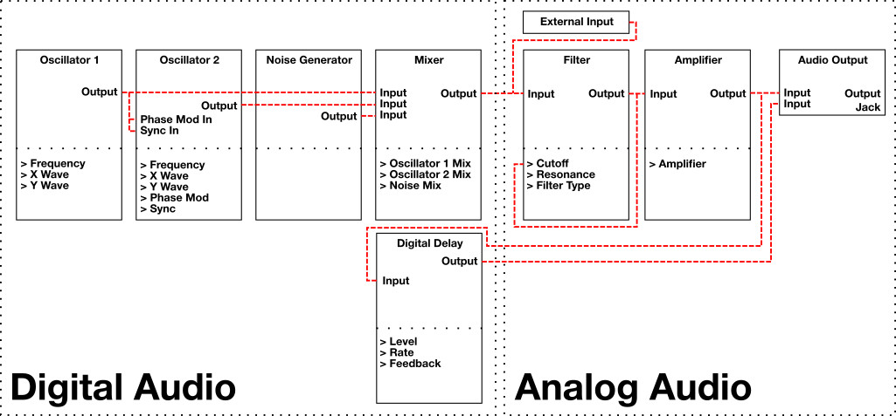
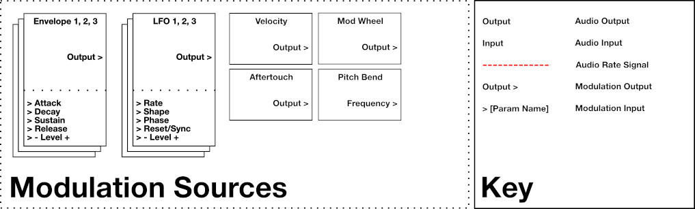

# **Overview**

## Hardware

Hardware components listed in the manual will be referred to by their name as listed below. When hardware components are listed in the manual, they will appear in **_Bold and Italic_**

1. **_OLED Display_**
2. **_Data Rotary Encoder_** \- (with switch when pressing down on shaft)
3. **_Shift switch_**
4. **_Play/Stop switch_**
5. **_Layer LEDs_**
6. **_View switches_**
7. **_Page LEDs_**
8. **_Key switches_**
9. **_Potentiometers_**
10. **_Volume knob_**
11. **_Output Audio jack_**
12. **_External Input Audio Jack_**
13. **_Filter tracking tuning trimpot_**
14. **_Filter offset trimpot_**
15. **_MIDI Output jack_**
16. **_MIDI Input jack_**
17. **_Power supply jack_** - (9v DC - Center positive)

## Synthesizer Block Diagram

## Specification
Iosefka is a hybrid digital analog monophonic synthesizer consisting of the following parts:

**Digital audio:**

  - 2x wavetable oscillators, capable of interpolated morphing waveforms in the X and Y dimension along 256 hand-picked waveforms in a 16x16 layout
  - White noise generator
  - Sample-rate reduction and Bit-rate reduction effects
  - Loopback digital delay fed from VCA output with feedback and adjustable rate from >3 ms to ~683 ms

**Analog audio:**

  - V2140 based analog pole-mixing resonant voltage controlled filter with audio rate frequency modulation selectable between:
    - 2 pole low pass
    - 4 pole low pass
    - 2 pole high pass
    - 2 pole band pass
  - LM13700 based voltage controlled amplifier
  - External audio input direct into analog section and digital delay

**Step sequencer:**

  - 32 step, 24 PPQ performance step sequencer
  - Parameterized sequence generator including step chance, length, octave range, and musical scale
  - Controls for swing, direction, clock division, first and last step, probability
  - Per step Parameter locks for:
    - Note value
    - Step length
    - Velocity value
    - Step Probability
    - Single audio Parameter
  - Per step mutes

**Modulation matrix to all audio Parameters:**

  - 3x ADSR envelope generators (converted to control voltage for analog modules)
  - 3x Low frequency oscillators (converted to control voltage for analog modules)
  - Velocity control
  - Aftertouch control
  - Mod Wheel control
  - Breath Control
  - Pitch Bend Control

**MIDI Implementation:**

  - **MIDI RX**
    - Note and velocity values
    - Realtime messages: clock tick, start, stop
    - CC messages for all audio Parameters (see implementation chart)
    - Modulation control of velocity, aftertouch, mod-wheel
    - Pitch bend with configurable bend range from 1 to 12 semitones
    - Program change (coming soon)
  - **MIDI TX**
    - Note and velocity values (from keyboard and sequencer)
    - Realtime messages: clock tick, start, stop

**Patch storage:**

  - Store 64 patches of all audio and sequencer Parameters
  - Store global MIDI and machine settings

**Oscilloscope:**

  - Oscillator phase locked oscilloscope with four 'time' divisions (sample divisions) between 512 to 128 samples.