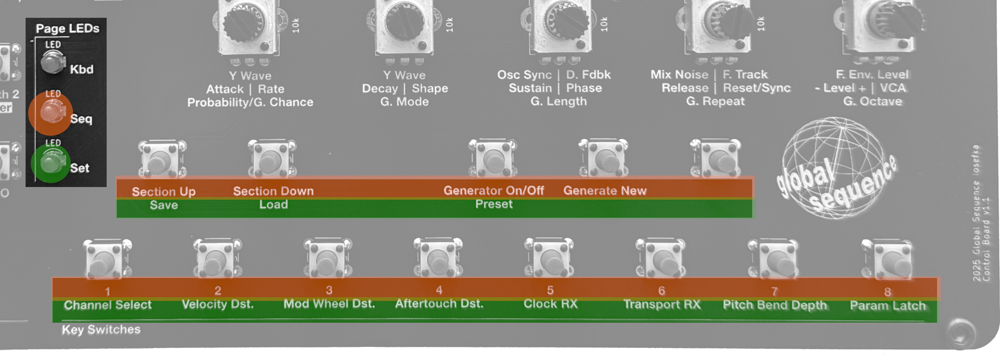
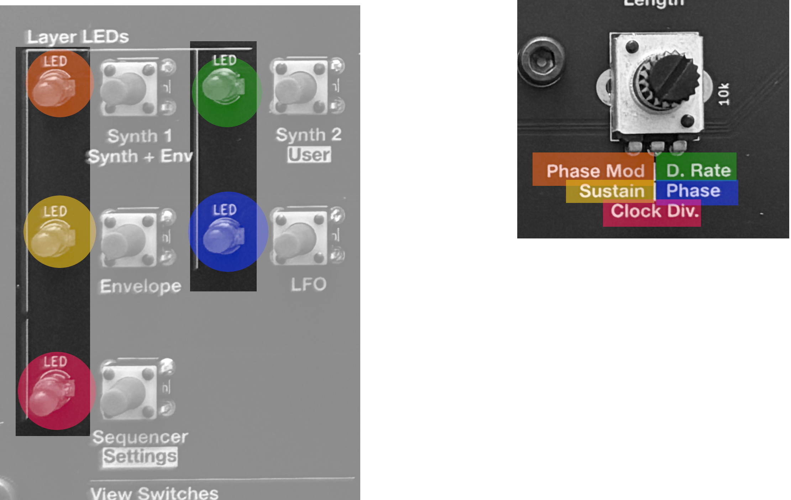
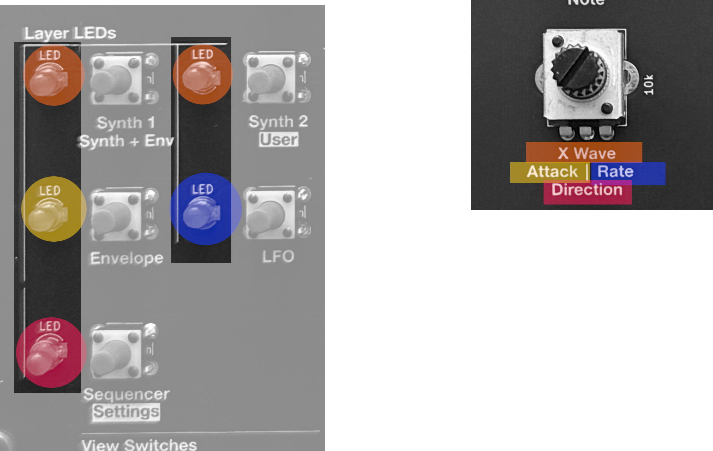

# **Operation**

## Powering the device

Iosefka requires a **9v DC center-positive** power supply. It is preferable to use a linear power supply (such as the one outlined in the BOM) instead of a switching power supply, in order to reduce noise.

The unit does not have a built-in on/off switch, so operation begins when the power supply is plugged in and ends when it is unplugged.

## Plugging into an external audio source

Iosefka provides line level mono output. Simply plug a ¼" cable into Iosefka's **_Output Audio jack_** and plug the other end into your mixer or audio interface, adjusting the volume with the **_Volume knob_** as needed.

Iosefka does not have a headphone output. It is not advised to plug headphones directly into Iosefka's **_Output Audio Jack_**.

## Playing Sounds

You can play sounds on Iosefka in a variety of ways. Most of these ways will be elaborated on in their own sections, but as a basic rundown:

### Playing sounds with the built-in keyboard

When the **Kbd Page** is active (by pressing the **Synth 1**, **Synth 2**, **Envelope**, or **LFO _View switches_**), the 13 **_Key Switches_** play chromatic musical semitones. The lower 8 switches represent white keys and the upper 5 switches represent black keys.

Furthermore, in the **Synth 1** and **Synth 2 Views**, the **Keyboard Octave Mode** is active, allowing for selecting between octave 2 through 7 of the 128 MIDI standard notes with the **_Data rotary encoder_**.

### Playing sounds with the Sequencer

You can just let the synth play itself by pressing the **_Play/Stop switch_**, provided that there is an active sequencer Pattern.

More information on the Sequencer can be found in the [Sequencer](./sequencer.md) section of this document.

### Playing sounds via MIDI

Iosefka comes with robust MIDI implementation according to the MIDI 1.0 standard. You can plug in any device that produces MIDI Note messages like a keyboard or a computer with a DAW into the **_MIDI Input Jack_** in the back of the device. Just make sure that the MIDI Channel in the **Settings View** matches the MIDI channel of your MIDI output device.

More information can be found in the [MIDI Implementation](./midi.md) section of this document.

### Just let it drone my dude

By disabling the VCA, Iosefka becomes a drone synthesizer, so it's constantly playing sound. From the **Synth 1 Layer**, press the ***Shift Switch*** and turn the ***Mix 1 Potentiometer*** above the "00" value to open the VCA to enter drone mode. Turning the value to "FF" will turn drone mode to full VCA gain.

When the VCA parameter it 00, the VCA is fully closed and will only open with Envelope 3.

## The _OLED Display_ and _LEDs_

The combination of the **_OLED Display_** and the eight **_LEDs_** on Iosefka are meant to give thorough visual feedback on the machine's control state, known as the **View** (more on the **View** in the section below). Learning this combination is crucial to the workflow of the machine.

Most changes on the physical interface will be reflected somehow on the ***OLED Display***. For example, when you turn a **_Potentiometer_**, a value relating to the placement of that potentiometer will change on the **_OLED Display_**. For example, turn the top left **_Potenetiometer_** and you'll see the number in the top left of the **_OLED Display_** change. Knowing that the currently lit **_Layer LED_** corresponds to the 15 numbers currently showing on the **_OLED Display_** will help you know which Parameters those numbers represent.

A detailed description of the different screens shown on the **_OLED Display_** and **_LEDs_** is provided in the [View Charts](./supplemental.md#view-charts) section of this document.

### OLED Display

#### A note on the use of hexadecimal

The display on Iosefka is 128x64 pixels. This plus the admittedly tiny size of the screen means that every character counts. 

Because of this, most numerical values controlled by a ***Potentiometer*** are displayed in hexadecimal, a base 16 number system, instead of the standard base 10 decimal number system. This is actually how many musical trackers display numerical values as well.

Moreover, Iosefka reads the **_Potentiometers_** at 8-bit resolution, meaning the voltage from the potentiometer is read as:

  - All the way down: 0 (0x00 in hexadecimal)
  - All the way up: 255 (0xFF in hexadecimal)
  - Halfway: 128 (0x80 in hexadecimal)

In brief, instead of counting like this:

- **0-1-2-3-4-5-6-7-8-9-10-11-12-13-14-15-16-17-18-19-20 … 251-252-253-254-255**

The Parameter values count like this:

- **0-1-2-3-4-5-6-7-8-9-A-B-C-D-E-F-10-11-12-13-14 … FB-FC-FD-FE-FF**

#### Values that are displayed in decimal

All numerical values controlled by the ***Data Rotary Encoder*** show as decimal values (...9, 10, 11...), as well as the following values on the **Sequencer View**:
- Length
- First Step
- Last Step
#### Bipolar values

Because of the aforementioned issue with space allotted to Parameter values, adding a negative "-" symbol would break the visual convention and hog screen space. As a compromise, bipolar values are displayed as positive hexadecimal values. For example, the values for the "- Level +" Parameters for the Modulation Sources are displayed as 0 to FF, but are in reality -80 to 7F, with 0 as the center value.

To be clear (or more confusing, I don't know):
- How it looks on the screen (positive hexadecimal): 
	- Value range: 00 - FF
	- The center value: 80
- How it works internally:
	- Value range: -128 - 127
	- The center value: 0

Bipolar values are mentioned in all parameters where they apply, and link back here for reference.
#### Hanging screens

A Hanging Screen is a screen which shows for just a few seconds, like showing the **Mode** when a **View** is changed, or any time the **_Data rotary encoder_** is turned. To view this screen for longer, hold down the **_Data rotary encoder_** switch by pressing down on the shaft. The Hanging Screen will persist for as long as the screen is held (plus a few seconds).

#### Display Off Timer

To maintain the longevity of the **_OLED Display_**, it will automatically turn off after 5 minutes if none of the physical components are changed (like turning a **_Potentiometer_**), or if the sequencer is not running, or if there are no incoming MIDI messages.

### LEDs

As mentioned above, the **_Layer LEDs_** and **_Page LEDs_** give visual feedback to the respective **Layer** and **Page** in the device's current **View**, described below.

## **The View**

The total state of the physical user interface is called the **View**. The **View** consists of three physical sections:

- **Pages** - The functions of the 13 **_Key switches_** on the control board
- **Layers** - The Parameters controlled by the 15 **_Potentiometers_** on the control board
- **Modes** - The data selectable by the single **_Data rotary encoder_** on the control board

Therefore, the **View** is determined by which state the **Page**, **Layer**, and **Mode** is currently set on the device. The OLED Display as well as the **_Layer LEDs_** and **_Page LEDs_** give visual feedback on which **View** is currently active.

### Changing the View

The View can be changed with the five **_View switches_** on the bottom left of the control board.

To see a list of all the **Views**, visit the [View Charts](./supplemental.md#view-charts) section of this document.

### Page

The function performed by each of the 13 **_Key switches_** is determined by which **Page** is currently active. The currently lit **_Page LED_** indicates the current page, and the function of that specific **_Key Switch_** is either:

- **Key Page** \- A musical semitone in the layout of a standard piano keyboard
- **Seq Page** \- The first line of text beneath the **_Key switch_**
- **Set Page** \- the second line of text beneath the **_Key switch_**

The image below illustrates how the **_Page LEDs_** indicate what each switch does. The orange sections indicate Sequencer functions and the green indicates Settings functions.

To see a list of all the **Pages** and their corresponding **_Key switch_** functions, visit the [Page Switch Function Chart](./supplemental.md#page-switch-function-chart) section of this document.

### Layer

Before delving into the Layer explanation, a definition: A _Parameter_ in the context of this document is any value that is changeable with a **_Potentiometer_**.

The **Layer** is the state which determines which parameter is controlled by one of the fifteen **_Potentiometers_** on Iosefka's control board. The **Layers** are arranged in a way that represents aspects of the synthesizer from a big-picture perspective. For example, the **Synth 1 Layer** contains the parameters for the oscillators, mixer and filter, while the **Synth 2 Layer** contains additional synthesizer effects (with a few parameters that are shared with Layer 1). All parameters on the **Envelope** and **LFO Layers** are dedicated to those respective Modulation Sources.

The **_Layer LED_** that is currently lit indicates which Parameter name beneath the **_Potentiometer_** is currently active. To elaborate, in the image below, note the corresponding color over the **_Layer LEDs_** to the Parameter name beneath the **_Potentiometer_**. This applies to every Parameter beneath the **_Potentiometers_** on the control board e.g. top left **_Layer LED_** (Indicating **Synth 1 Layer**) = top left Parameter, etc.

**Note:** If only one Parameter name appears in a row, that means that Parameter is active for either layer in that row. For example in the below image, the Parameter "X Wave" is active when the active **Layer** is either **Synth 1** or **Synth 2**.

To see a list of all the **Layers** and their corresponding **_Potentiometer_** Parameters, visit the [Layer Parameter Control Chart](./supplemental.md#layer-parameter-control-chart) section of this document.

### Mode

The **_Data rotary encoder_** is responsible for handling the input of specific data values depending on which **Page** or **Layer** is currently active, as well as several other contexts. The state which determines the data being handled by the **_Data rotary encoder_** is called the **Mode**.

The **Mode** controls things like the octave of the notes played on the keyboard, the modulation destination of all Modulators, the BPM of the Sequencer, etc.

On all **Views** except for the **Settings View**, the current **Mode** can be viewed in a few different ways:

- Pressing down on the **_Data rotary encoder_** shaft to actuate the switch
- Switching the **View**
- Turning the **_Data rotary encoder_**

To see a list of all the **Modes**, their contexts, and how to view them, visit the [Mode Encoder Data Chart](./supplemental.md#mode-encoder-data-chart) section of this document.