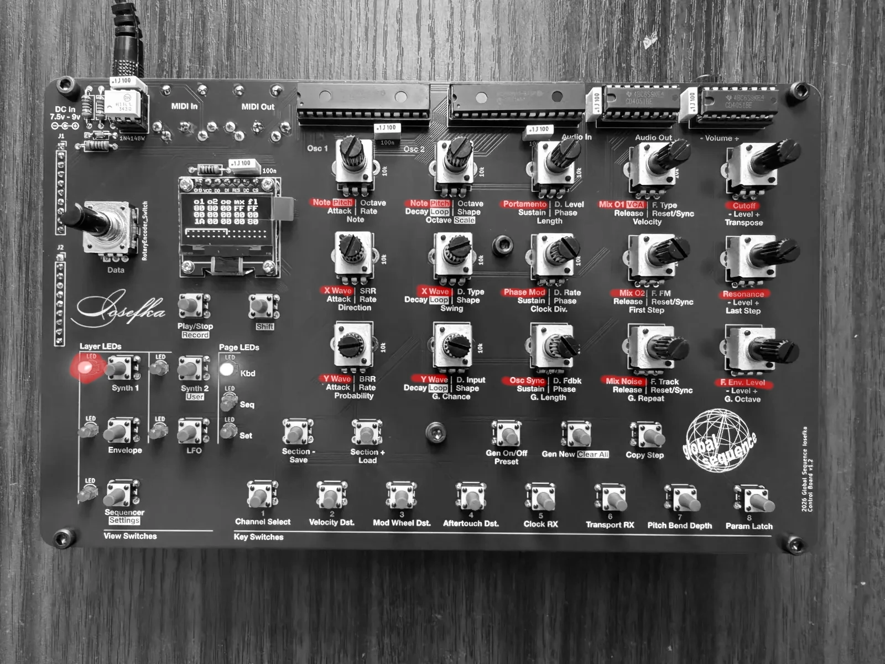
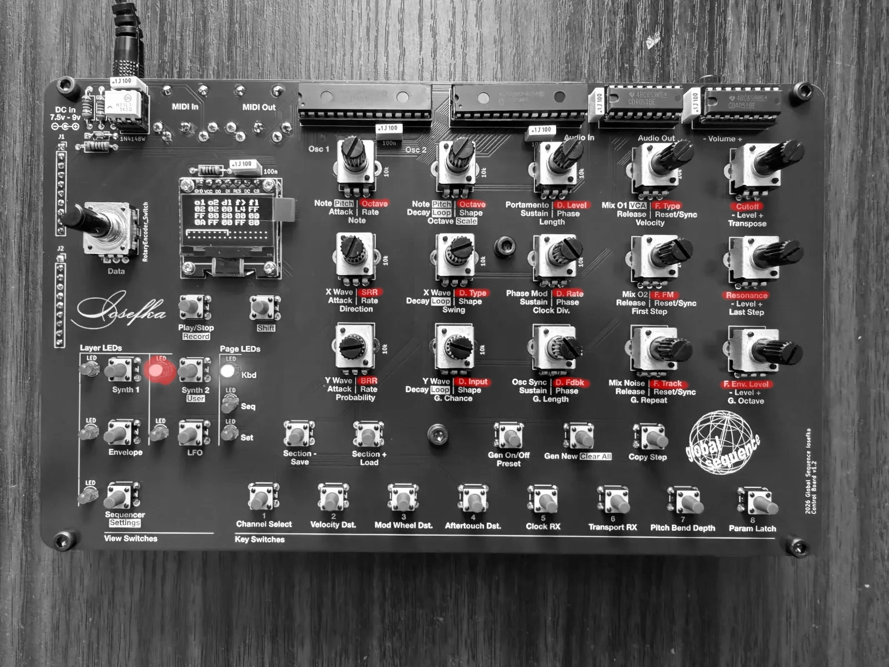
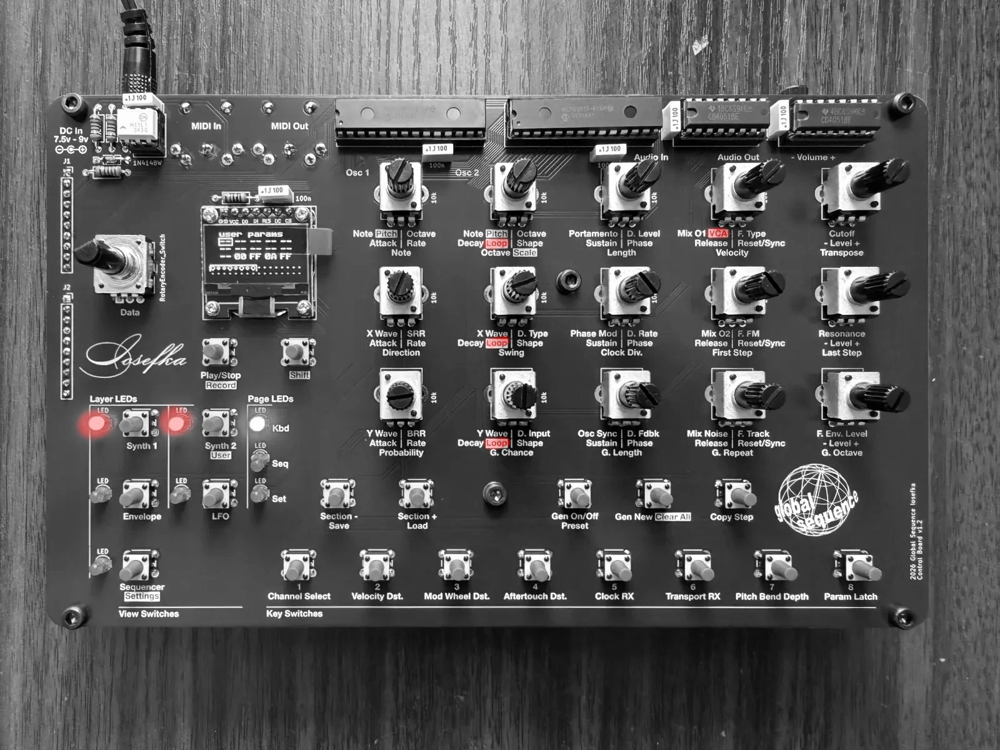
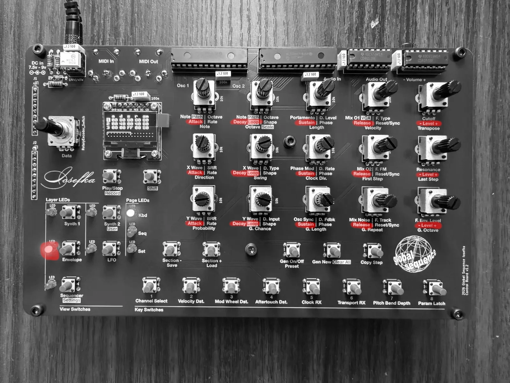
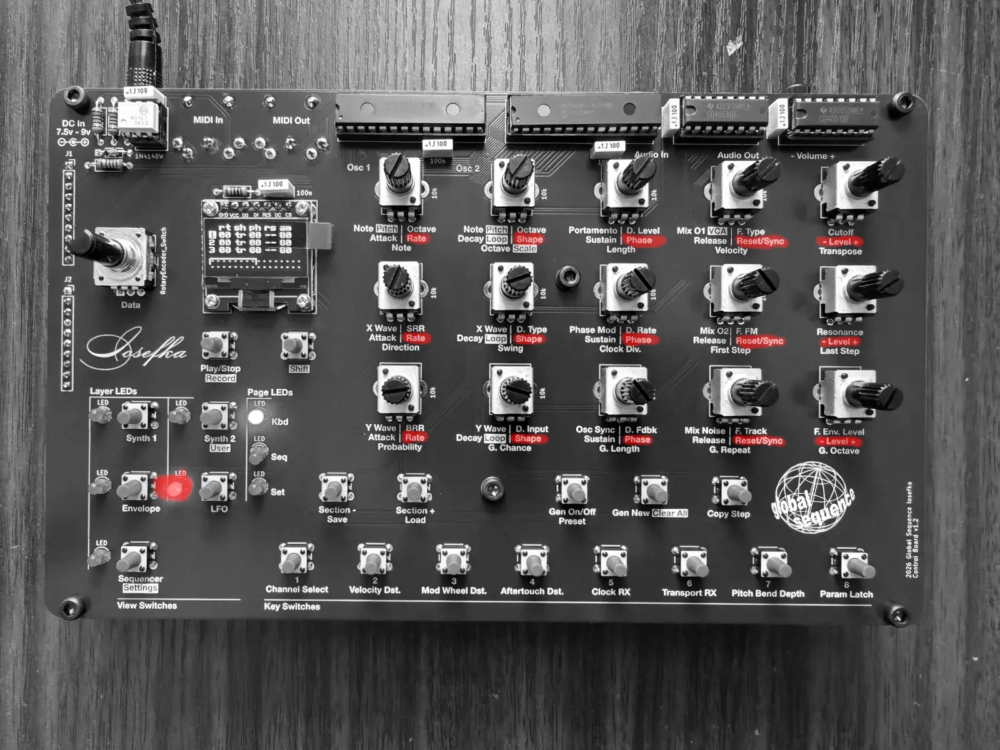
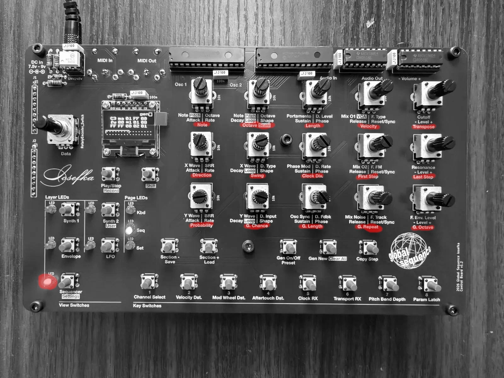
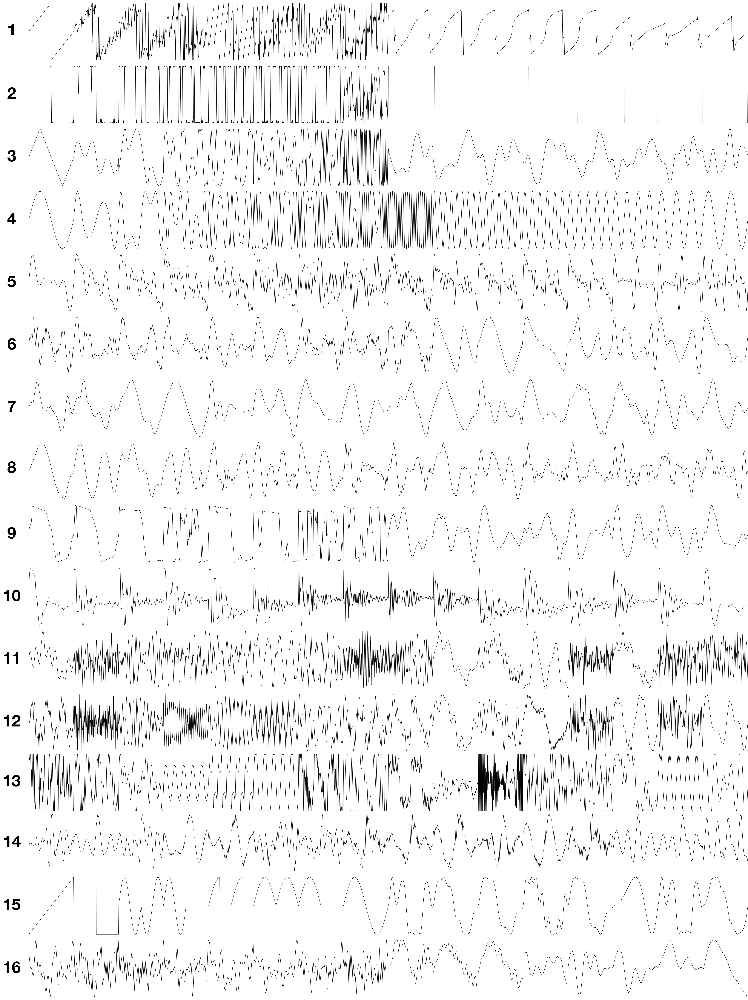

# **Supplemental Information**

## View Charts

These charts represent the default **Layers**, **Pages**, and **Modes** upon device startup. These three can be changed depending on the **View**, and sometimes persist beyond **View** changes. For example, if the **Mode** is changed in the **Settings View**, that mode will persist when leaving and returning to the **Settings View**.

| **View Name** | **Accessing this View**                             | **Layers**              | **Pages**   | **Modes**                                             |
| ------------- | --------------------------------------------------- | ----------------------- | ----------- | ----------------------------------------------------- |
| Synth 1       | **Synth 1 View switch_**\*                          | [Synth 1](#synth-1)     | [Kbd](#kbd) | [kbd oct (Keyboard Octave)](#kbd-oct-keyboard-octave) |
| Synth 2       | **Synth 2/User _View switch_**                      | [Synth 2](#synth-2)     | [Kbd](#kbd) | [kbd oct (Keyboard Octave)](#kbd-oct-keyboard-octave) |
| User          | **_Shift switch_** + **Synth 2/User _View switch_** | [User](#user)           | [Kbd](#kbd) | [kbd oct (Keyboard Octave)](#kbd-oct-keyboard-octave) |
| Envelope      | **Envelope _View switch_**                          | [Envelope](#envelope)   | [Kbd](#kbd) | [Envelope 1, 2, 3](#envelope-1-2-3)                   |
| LFO           | **LFO _View switch_**                               | [LFO](#lfo)             | [Kbd](#kbd) | [LFO 1, 2, 3](#lfo-1-2-3)                             |
| Sequencer     | **Sequencer _View switch_**                         | [Sequencer](#sequencer) | [Seq](#seq) | [seq bpm (Sequencer BPM)](#seq-bpm-sequencer-bpm)     |
| Settings      | **_Shift switch_** + **Sequencer _View switch_**    | N/A\*\*                 | [Set](#set) |                                                       |

\*Hitting this switch multiple times toggles between Synth 1 View and Synth Env View. Whichever View was active when leaving the View by hitting another **_View switch_** will be the view that is active when hitting the **Synth 1/Synth Env _View switch_** again. Iosefka always starts up in Synth 1 View.

\*\* When in the Settings View, the most recent layer from the previous view remains active.

## Page Switch Function Chart

### Kbd

| **_Key switch_** | **Function** |
| --- | --- |
| All **_Key switches_** | 1 octave + 1 note, in the layout of a piano keyboard |

### Seq

| **_Key switch_**     | **Function**                                                                                                                                                                                                                                                    |
| -------------------- | --------------------------------------------------------------------------------------------------------------------------------------------------------------------------------------------------------------------------------------------------------------- |
| **Section -**        | Jogs through the [Step Sections](./sequencer.md#step-sections) counting down in steps. If the ***Shift Switch*** is held, a [Section Jump](./sequencer.md#section-jumping) downward occurs. If the ***Copy Switch*** is held, a                                 |
| **Section +**        | Jogs through the [Step Sections](./sequencer.md#step-sections) counting down                                                                                                                                                                                    |
| **Generator On/Off** | Enables/Disables the Generator for [Running Generation](./sequencer.md#running-generation)                                                                                                                                                                      |
| **Generate New**     | Generates a Pattern via [Immediate Generation](./sequencer.md#immediate-generation)                                                                                                                                                                             |
| **1 - 8**            | Programs the step corresponding to the current [Step Section](./sequencer.md#step-sections) See [Manual Programming](./sequencer.md#manual-programming) subsection for an in-depth description of using these switches to program a Pattern in the Sequencer |

### Set

| Key switch | Function                                                                                                                               |
| --- | --- |
| Save | - Pressing once readies the Save state    - Pressing Shift key plus Save Key switch while in Save state saves to the current preset |
| Load | - Pressing once readies the Load state    - Pressing Shift key plus Save Key switch while in Load state saves to the current preset |
| Preset | Sets the Mode to Preset Select                                                                                                         |
| Channel Select | Sets the Mode to Channel Select                                                                                                        |
| Velocity Dst. | Sets the Mode to Velocity Destination Select                                                                                           |
| Mod Wheel Dst. | Sets the Mode to Mod Wheel Destination Select                                                                                          |
| Aftertouch Dst. | Sets the Mode to Aftertouch Destination Select                                                                                         |
| Clock Rx | Enables Clock Receive from the input MIDI source                                                                                       |
| Transport Rx | Enables Transport Receive from the input MIDI source                                                                                   |
| Pitch Bend Depth | Sets the Mode to Pitch Bend Depth Select                                                                                               |
| Param Latch | Toggles the Parameter Latch function on/off. See the [List of Parametric Settings](./settings.md#list-of-parametric-settings)          |

## Layer Parameter Control Chart
In the photos below, the text for each parameter below the **_Potentiometer_** is highlighted respective to the current layer. 

See "Parameters" sections in [The Synthesizer](./synthesizer.md) and [The Sequencer](./sequencer.md) for in-depth explanations on these Parameters

### Synth 1

|                           |                           |            |                    |               |
| ------------------------- | ------------------------- | ---------- | ------------------ | ------------- |
| Note/Pitch (Oscillator 1) | Note/Pitch (Oscillator 2) | Portamento | Mix 1, shift = VCA | Cutoff        |
| X Wave (Oscillator 1)     | X Wave (Oscillator 2)     | Phase Mod  | Mix 2              | Resonance     |
| Y Wave (Oscillator 1)     | Y Wave (Oscillator 2)     | Osc Sync   | Mix Noise          | F. Env. Level |

### Synth 2

|                          |                          |          |          |               |
| ------------------------ | ------------------------ | -------- | -------- | ------------- |
| Octave (Oscillator 1) | Octave (Oscillator 2) | D. Level | F. Type  | Cutoff        |
| SRR                      | D. Type                  | D. Rate  | F. FM    | Resonance     |
| BRR                      | D. Input                 | D. Fdbk  | F. Track | F. Env. Level |

### User

See [User Parameters](#user-parameters) section for how to access and set User Parameters.

### Envelope

|                     |                                     |                         |                         |                            |     |
| ------------------- | ----------------------------------- | ----------------------- | ----------------------- | -------------------------- | --- |
| Attack (Envelope 1) | Decay, Shift = Loop (Envelope 1) | Sustain (Envelope 1) | Release (Envelope 1) | \- Level + (Envelope 1) |     |
| Attack (Envelope 2) | Decay, Shift = Loop (Envelope 2) | Sustain (Envelope 2) | Release (Envelope 2) | \- Level + (Envelope 2) |     |
| Attack (Envelope 3) | Decay, Shift = Loop (Envelope 3) | Sustain (Envelope 3) | Release (Envelope 3) | \- Level + (Envelope 3) |     |

### LFO

|                 |                  |                  |                         |                       |
| --------------- | ---------------- | ---------------- | ----------------------- | --------------------- |
| Rate (LFO 1) | Shape (LFO 1) | Phase (LFO 1) | Reset/Sync   (LFO 1) | \- Level + (LFO 1) |
| Rate (LFO 2) | Shape (LFO 2) | Phase (LFO 2) | Reset/Sync   (LFO 2) | \- Level + (LFO 2) |
| Rate (LFO 3) | Shape (LFO 3) | Phase (LFO 3) | Reset/Sync   (LFO 3) | \- Level + (LFO 3) |

### Sequencer

|             |              |            |            |           |
| ----------- | ------------ | ---------- | ---------- | --------- |
| Note        | Octave/Scale | Length     | Velocity   | Transpose |
| Direction   | Swing        | Clock Div. | First Step | Last Step |
| Probability | G. Chance    | G. Length  | G. Repeat  | G. Octave |

## Mode Encoder Data List

### kbd oct (Keyboard Octave)

Sets octave played the **_Key switches_** on the **Kbd Page** in a five octave range from 2 - 7.

_Why 2 - 7 and not 0 - 9 for more octaves?_ This is so that the Synthesizer Octave Parameters are still useful.

### seq bpm (Sequencer BPM)

Sets the Sequencer speed from 30 - 300 BPM (beats per minute).

### preset (Preset Number)

Selects from the 64 presets on Iosefka. Note that the number counts from 1 - 64, note hexadecimal.

### channel (MIDI Channel)

Selects from MIDI channel 1 - 16.

Incoming MIDI messages such as Note On, Note Off, Velocity, CC, Mod Wheel, Aftertouch, which are sent to this channel will take effect according to machine settings. All messages of those types on other channels will be ignored.

### Modulation Destination Modes

In these **Modes**, the **Data rotary encoder** is used to select the [Modulation Destination](#modulation-destinations) assigned to the respective Modulation Source.

The options are the same for every **Mode** below, as all modulation sources have access to all modulation destinations.

#### Mod Destination Jump

When selecting a Mod Destination for a Mod Source, there are dozens to choose from. The destinations have been grouped in the UI to be relevant to which erm... 'module' the Mod Destination is a part of.

When Pressing and Holding the ***Encoder Switch*** while turning the ***Rotary Encoder***, the selected Mod Destination will jump to the first parameter per each group of relevant parameters, for easier navigation of the Mod Destinations. The below table shows the Mod Destinations jumped to when performing this action.

|                |
| -------------- |
| none           |
| oscs pitch c   |
| osc 1 pitch c  |
| osc 2 pitch c  |
| portamento     |
| mixer osc 1    |
| filter cutoff  |
| vca            |
| delay rate     |
| env 1 rate     |
| env 2 rate     |
| env 3 rate     |
| lfo 1 rate     |
| lfo 2 rate     |
| lfo 3 rate     |

#### Envelope 1, 2, 3

For the Envelopes. To see how to select these modes, refer to the [Selecting Envelope and LFO modulation destinations](./synthesizer.md#selecting-envelope-and-lfo-modulation-destinations) section.

#### LFO 1, 2, 3

For the LFOs. To see how to select these modes, refer to the [Selecting Envelope and LFO modulation destinations](./synthesizer.md#selecting-envelope-and-lfo-modulation-destinations) section.

#### vel (Velocity)

For Velocity from both the Sequencer steps and the incoming MIDI notes

#### m.w. (Mod Wheel)

For Mod Wheel messages coming from the MIDI input

#### a.t. (Aftertouch)

For Channel Aftertouch messages coming from the MIDI input

## User Parameters

For performance, and overall ease of use, users are able to assign fifteen synthesizer parameters on the **User Parameter Layer**. Every Preset can have its own user parameters. 

By default, there are user parameters that are already set. These are parameters that require the use of the ***Shift Switch*** on their respective layers. The ***Potentiometer*** assigned to these default User Parameters are:
- 12: Envelope 1 Loop
- 13: Envelope 2 Loop
- 14: Envelope 3 Loop
- 15: VCA Level

Note: Sequencer parameters cannot be set as user parameters. 
#### Navigating to User Parameters View
Navigate to the **User Parameter Layer** by holding the **_Shift switch_** and pressing the **_Synth 2 switch_**. 

#### Selecting the Potentiometer the User Parameter is assigned to
Select the Potentiometer which will be assigned a parameter by holding the **_Shift switch_** and turning the **_Data rotary encoder_**. A box will be drawn around the currently selected parameter.

#### Selecting the User Parameter
From here, turning the **_Data rotary encoder_** selects the parameter which can be assigned. The parameter value of the current preset will be shown. Note: Changing the parameter value here will change the value on the respective layer and vice versa.

Some parameters cannot be assigned, and are indicated by a "--" in place of the parameter value when that parameter is selected. This is how all parameters appear on a new Preset.

## Layer Decoupling
Using Layer Decoupling, you can do like the following:
- Enter synthesizer parameter locks to sequencer steps
- Live step record while tweaking Sequencer parameters

To do this: 
- Press and hold the ***View Switch*** of the layer you'd like to maintain
- Press the ***View Switch*** of the **Page** and **Mode** you'd like to use

For example, press and hold the ***Synth 1 View Switch***, then press the ***Seq View Switch***. You will see the ***Seq Page LED*** light up and the Sequencer BPM Mode Hanging Display. 
## Wavetable Chart

Below is a chart of wavetables in Iosefka. The wavetables are represented by X values horizontally and Y values vertically, meaning that when you turn the **X Wave _Potentiometer_**, you are scanning the chart below from left to right, and when you turn the **_Y Wave Potentiometer_**, you are scanning the table from top to bottom.

The wavetables are arranged in the machine such that each Y value wavetable represents a different type of instrument/timbre/synthesis, and each X value is a variation of that timbre.

The wavetables represented by the chart above:

1. Metallized saw wave (1-8), notched saw wave (9-16)
2. Metallized square wave (1-8), PWM square wave (9-16)
3. Triangle wave experimentations
4. Frequency modulated sine (1-8), sine with increasing octaves (9-16)
5. Drawbar organ tones
6. Piano (1-8), e piano (9-16)
7. Clarinet (1-5), Oboe (6-10), saxophone (11-16)
8. Violin (1-8), cello (9-16)
9. Electric guitar (1-8), acoustic guitar (9-16)
10. Asst. wavetables from Mutable Instruments Plaits
11. Asst. bell sounds
12. Asst. harmonically-rich wavetables
13. Formant synthesis wavetables from Mutable Instruments Braids
14. PPG waveforms
15. Yamaha-style OPL FM chip waveforms
16. Assorted Ensoniq wavetables

A higher quality version of the chart below can be found here.

## Modulation Destinations

| **Destination name** | **Affected Parameter(s)**                                             |
| -------------------- | --------------------------------------------------------------------- |
| None                 | None                                                                  |
| oscs pitch c         | Both Oscillators Coarse Pitch across 8 octaves                        |
| oscs pitch f         | Both Oscillators Fine Pitch across 2 semitones                        |
| oscs octave          | Both Oscillators Octave                                               |
| oscs x morph         | Both Oscillators X Wave                                               |
| oscs y morph         | Both Oscillators Y Wave                                               |
| osc 1 pitch c        | Oscillator 1 coarse pitch across 8 octaves                            |
| osc 1 pitch f        | Oscillator 1 fine pitch across 2 semitones (for vibrato like effects) |
| osc 1 octave         | Oscillator 1 octave                                                   |
| osc 1 x morph        | Oscillator 1 X Wave                                                   |
| osc 1 y morph        | Oscillator 1 Y Wave                                                   |
| osc 2 pitch c        | Oscillator 2 coarse pitch across 8 octaves                            |
| osc 2 pitch f        | Oscillator 2 fine pitch across 2 semitones (for vibrato like effects) |
| osc 2 octave         | Oscillator 2 octave                                                   |
| osc 2 x morph        | Oscillator 2 X Wave                                                   |
| osc 2 y morph        | Oscillator 2 Y Wave                                                   |
| portamento           | Portamento                                                            |
| phase mod            | Phase Modulation                                                      |
| sync                 | Oscillator sync                                                       |
| brr                  | Bit-rate Reduction                                                    |
| srr                  | Sample-rate reduction                                                 |
| mixer osc 1          | Oscillator 1 Mixer Level                                              |
| mixer osc 2          | Oscillator 2 Mixer Level                                              |
| mixer noise          | Noise Generator Mixer Level                                           |
| unused               | Unused (for now)                                                      |
| filter cutoff        | Filter Cutoff                                                         |
| filter res           | Filter Resonance                                                      |
| filter env amt       | Filter Envelope Level                                                 |
| filter type          | Filter Type                                                           |
| filter fm            | Filter Frequency Modulation                                           |
| filter tracking      | Filter Tracking                                                       |
| vca                  | VCA Level                                                             |
| delay rate           | Delay Rate                                                            |
| delay feedback       | Delay Feedback                                                        |
| delay level          | Delay Level                                                           |
| delay type           | Delay Type                                                            |
| delay input          | Delay Input Level                                                     |
| env 1 attack         | Envelope 1 Attack                                                     |
| env 1 decay          | Envelope 1 Decay                                                      |
| env 1 sustain        | Envelope 1 Sustain                                                    |
| env 1 release        | Envelope 1 Release                                                    |
| env 1 level          | Envelope 1 Level                                                      |
| env 1 loop           | Envelope 1 Loop                                                       |
| env 1 dst            | Envelope 1 Destination                                                |
| env 2 attack         | Envelope 2 Attack                                                     |
| env 2 decay          | Envelope 2 Decay                                                      |
| env 2 sustain        | Envelope 2 Sustain                                                    |
| env 2 release        | Envelope 2 Release                                                    |
| env 2 level          | Envelope 2 Level                                                      |
| env 2 loop           | Envelope 2 Loop                                                       |
| env 2 dst            | Envelope 2 Destination                                                |
| env 3 attack         | Envelope 3 Attack                                                     |
| env 3 decay          | Envelope 3 Decay                                                      |
| env 3 sustain        | Envelope 3 Sustain                                                    |
| env 3 release        | Envelope 3 Release                                                    |
| env 3 level          | Envelope 3 Level                                                      |
| env 3 loop           | Envelope 3 Loop                                                       |
| env 3 dst            | Envelope 3 Destination                                                |
| lfo 1 rate           | LFO 1 Rate                                                            |
| lfo 1 shape          | LFO 1 Shape                                                           |
| lfo 1 phase          | LFO 1 Phase                                                           |
| lfo 1 sync           | LFO 1 Reset/Sync                                                      |
| lfo 1 level          | LFO 1 Level                                                           |
| lfo 1 dst            | LFO 1 Destination                                                     |
| lfo 2 rate           | LFO 2 Rate                                                            |
| lfo 2 shape          | LFO 2 Shape                                                           |
| lfo 2 phase          | LFO 2 Phase                                                           |
| lfo 2 sync           | LFO 2 Reset/Sync                                                      |
| lfo 2 level          | LFO 2 Level                                                           |
| lfo 2 dst            | LFO 2 Destination                                                     |
| lfo 3 rate           | LFO 3 Rate                                                            |
| lfo 3 shape          | LFO 3 Shape                                                           |
| lfo 3 phase          | LFO 3 Phase                                                           |
| lfo 3 sync           | LFO 3 Reset/Sync                                                      |
| lfo 3 level          | LFO 3 Level                                                           |
| lfo 3 dst            | LFO 3 Destination                                                     |

## Oscilloscope
Users can view the VCA output waveform of the synthesizer using the oscilloscope. The audio is fed back into Iosefka's processor using the same buffer as the delay. The delay output is not displayed in the oscilloscope.

The oscilloscope captures the output waveform in real time and displays them to the user from one of four user selected magnifications. The magnification value shown on the ***OLED Display*** shows how zoomed in the oscilloscope is, relative to the samples captured. To best see lower notes, a value of 1x is best. To see higher notes, a value of 8x is best.

| Magnification value | Sample size | Sample division (display every n samples) |
| ------------------- | ----------- | ----------------------------------------- |
| 1x                  | 1024        | 8                                         |
| 2x                  | 512         | 4                                         |
| 4x                  | 256         | 2                                         |
| 8x                  | 128         | 1                                         |

The oscilloscope is phase-locked to oscillator 1, meaning that the waveform *should* stay in the same place on the screen regardless of the pitch of the note that's playing. This is done by triggering a reset of the oscillator's capture window when oscillator 1's phase overflows, as indicated by the oscillator sync buffer. 

The phase will not appear locked with the audio in the following scenarios:
- Oscillator 1 and 2 pitch are dissonant
- Oscillator 1 is low or off, and Oscillator 2 or resonant filter is the primary audio source
- Oscillator 1's pitch is lower than the magnification can capture in one screen (if the waveform is 'larger' than will fit in one screen)

Only 128 discrete points are rendered for each 'frame' of the oscilloscope, meaning that harmonically rich waveforms, or viewing higher pitches on lower magnifications will make the oscilloscope appear more 'broken up'. While the solution would be to draw a line between each discrete point, this is not possible due to processor limitations. I tried folks. 